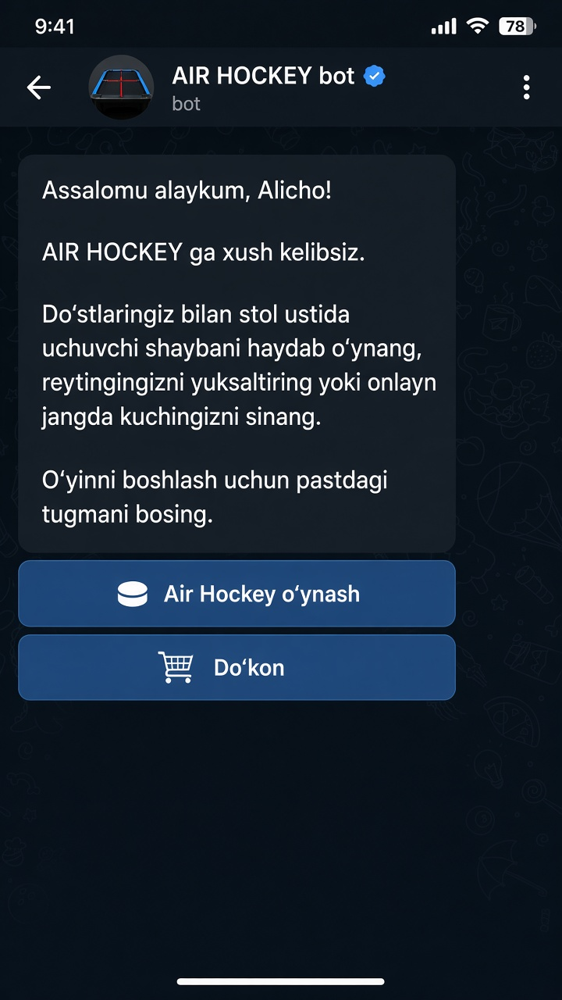

# GAME BOT (`@mcee77bot`)

Telegram Mini App — **Air Hockey**, online/offline o‘yin, ball va reyting.

Primary entry = Telegram Mini App shell at `${WEBAPP_URL}/app/` (Profil · O‘yin · Reyting). Account = Telegram (`telegram_id`).

**Live:** https://web-production-05946.up.railway.app · **Bot:** [@mcee77bot](https://t.me/mcee77bot)

## Stack (MVP)

- **Bot:** Node.js + TypeScript + [grammY](https://grammy.dev)
- **API + Mini App:** Fastify (`/api/v1/*` + static shell/game + WebSocket)
- **Realtime:** `@fastify/websocket` — presence + Air Hockey matchmaking
- **DB:** shared `@mcee77/db` — **PostgreSQL** when `DATABASE_URL` is set, else **SQLite** (`better-sqlite3`) for local/dev
- **Layout:** npm workspaces — `apps/bot`, `apps/api`, `packages/db`, `packages/shared`

## Scoring / Ball qoidalari

| Rejim | Ball / reyting |
|-------|----------------|
| **Online** (random yoki taklif) | G‘alaba/mag‘lubiyat server tomonidan yoziladi (`matches` + `scores`) |
| **Offline** (AI yoki 2 o‘yinchi) | **Hech qachon ball bermaydi** (g‘alaba ham, mag‘lubiyat ham) |

## Setup / O‘rnatish

1. **Token** — [BotFather](https://t.me/BotFather) dan `@mcee77bot` tokenini oling.
2. Copy env file:

```bash
cp .env.example .env
```

3. `.env` ni to‘ldiring (real tokenni gitga commit qilmang):

```env
TELEGRAM_BOT_TOKEN=123456:ABC...
WEBAPP_URL=https://<your-https-tunnel>
ALLOW_DEV_SCORE_SUBMIT=true
```

4. Install & run:

```bash
npm install
npm run build
npm run dev:api    # http://127.0.0.1:3000/app/  +  /air-hockey/
npm run dev:bot    # long polling
```

Telegram Mini App uchun HTTPS kerak — lokalda `ngrok` / `cloudflared` bilan `WEBAPP_URL` ni tunnel qiling.

## Mini App shell (`/app/`)

Bottom nav **faqat 3 tab**:

1. **Profil** — avatar (yuklash), nickname tahrirlash, o‘yin nomi **Air Hockey**, ball/reyting
2. **O‘yin** — online ro‘yxat (bo‘shsa «Onlinelar yo‘q»), taklif, random matchmaking, **Offline o‘ynash**
3. **Reyting** — o‘rin, o‘yinchi, ball/reyting

Presence: Mini App ochiq bo‘lganda `wss://…/ws/presence` heartbeat.

Vertical swipe/pull-to-close o‘chirilgan (`Telegram.WebApp.disableVerticalSwipes` + `overscroll-behavior: none`); yopish faqat Telegram header **X** orqali.

Play deep-links:

- Offline AI: `/air-hockey/?mode=ai&from=app`
- Online random: `/air-hockey/?mode=online&from=app`
- Invite: `/air-hockey/?mode=online&invite=<key>`

### Brauzerda (dev)

1. `ALLOW_DEV_SCORE_SUBMIT=true`
2. `npm run dev:api`
3. [http://127.0.0.1:3000/app/](http://127.0.0.1:3000/app/)

## Air Hockey

### Offline

`/air-hockey/?mode=ai` yoki `mode=local` — mashq; **ball yo‘q**.

### Online

Random queue yoki Mini App taklifi → `ws://…/ws/air-hockey` → server-authoritative natija.

## Bot

`/start` — **AIR HOCKEY** xush kelibsiz matni + stacked **inline** tugmalar (reply keyboard yo‘q):

1. **🏒 Air Hockey o‘ynash** — WebApp → `${WEBAPP_URL}/app/`
2. **🛒 Do‘kon** — hozircha «ombor to‘ldirilmoqda» adabiy javob (+ ixtiyoriy `/app/shop/` stub)

Profil / Reyting faqat Mini App ichida. Chat Menu Button **OCHISH** saqlanadi.



Commands: `/start` (asosiy), `/profile`, `/rating` (ixtiyoriy)

## Folder layout

```text
apps/bot/                     grammY Telegram bot
apps/api/                     Fastify REST + WS + static
apps/api/public/app/          Mini App shell (Profil / O‘yin / Reyting)
apps/api/public/air-hockey/   canvas Air Hockey
apps/api/src/air-hockey/      matchmaking + rooms
apps/api/src/presence/        online presence + invites
apps/api/src/admin/           /admin stats panel
packages/db/                  Postgres (DATABASE_URL) or SQLite users/scores/matches
packages/shared/              types + initData verify
data/                         Local SQLite + avatars (gitignored)
```

## Deploy (Railway)

Bitta servis: Fastify (REST + Mini App + WS) **va** grammY webhook.

| Variable | Required | Prod value |
|----------|----------|------------|
| `TELEGRAM_BOT_TOKEN` | **yes** | Game bot (@mcee77bot) token — never commit |
| `WEBAPP_URL` | **yes** | `https://web-production-05946.up.railway.app` |
| `ALLOW_DEV_SCORE_SUBMIT` | yes | `false` |
| `ADMIN_BOT_TOKEN` | **for Telegram admin** | Token for `@MCee_adminbot` (never commit) |
| `ADMIN_TELEGRAM_IDS` | **for Telegram admin** | Your numeric Telegram id(s), comma-separated |
| `ADMIN_SECRET` | optional web `/admin` | random string for browser panel |
| `PORT` | set by host | Railway injects |
| `BOT_MODE` | optional | `webhook` (Dockerfile default) |
| `DATABASE_URL` | **yes on Railway (Trial)** | Reference from Railway PostgreSQL plugin |
| `DATABASE_PATH` | optional SQLite fallback | `/data/gamebot.sqlite` (only if no `DATABASE_URL`) |
| `AVATAR_DIR` | optional | `/data/avatars` |
| `RAILWAY_RUN_UID` | only with Volume | `0` (Volume is root-owned; image runs as `node`) |
| `TELEGRAM_WEBHOOK_SECRET` | optional | random string |

### Railway PostgreSQL (recommended — works on Trial)

Railway **Trial** often has **no Volumes** in Settings, so SQLite under `/data` is wiped on every deploy. Use Postgres instead:

1. Railway project → **New** → **Database** → **PostgreSQL**.
2. Open the **web** (API) service → **Variables** → **Add Variable** / **Reference** → select `DATABASE_URL` from the Postgres service (Railway injects the connection string — do not paste secrets into git).
3. Redeploy the web service.
4. Check `GET /healthz`:
   - `databaseDriver`: `"postgres"`
   - `dbPersistent`: `true`
   - `databasePath`: `null`
   - `users`: row count (starts at `0` until people `/start` again)
5. Each player must `/start` [@mcee77bot](https://t.me/mcee77bot) once so their row is upserted into Postgres. Old ephemeral SQLite data cannot be recovered.

After this, redeploys keep users, ratings, matches, and admin broadcast recipients.

### Railway Volume (optional — SQLite only)

Volumes are **optional** when `DATABASE_URL` (Postgres) is set. Use a Volume only if you stay on SQLite or want durable avatar files on disk:

1. Service → **Add Volume** · mount path **`/data`** · set `RAILWAY_RUN_UID=0`.
2. Leave `DATABASE_URL` unset so the app uses SQLite at `/data/gamebot.sqlite`.
3. `GET /healthz` → `databaseDriver:"sqlite"`, `dbPersistent:true`, `volumeMount:"/data"`.

### BotFather Menu Button

After deploy:

1. [@BotFather](https://t.me/BotFather) → `/mybots` → `@mcee77bot`
2. **Bot Settings → Menu Button** (yoki **Configure Mini App**)
3. URL: **`${WEBAPP_URL}/app/`**  
   Masalan: `https://web-production-05946.up.railway.app/app/`

Chat ro‘yxatidagi **OCHISH** shu Menu Button dan chiqadi.

Other paths:

- Mini App: `${WEBAPP_URL}/app/`
- Air Hockey: `${WEBAPP_URL}/air-hockey/`
- Presence WS: `wss://<host>/ws/presence`
- Game WS: `wss://<host>/ws/air-hockey`
- Webhook: `${WEBAPP_URL}/telegram/webhook`
- Admin: `${WEBAPP_URL}/admin?key=<ADMIN_SECRET>`

### Post-merge checklist

1. Merge PR → Railway auto-redeploy (yoki manual redeploy)
2. Confirm Postgres: Variables include referenced `DATABASE_URL`
3. `GET /healthz` → `ok: true`, `databaseDriver: "postgres"`, `miniApp: "/app/"`
4. BotFather Menu Button = `https://…/app/`
5. Telegram da `/start` → **Air Hockey o‘ynash** → Profil / O‘yin / Reyting
6. Online o‘yin ball beradi; offline bermaydi

## Admin (Telegram — preferred)

Alohida admin bot: **[@MCee_adminbot](https://t.me/MCee_adminbot)** (o‘yin boti `@mcee77bot` dan farq qiladi).

**Railway Variables (majburiy admin uchun — token/id ni chatga yozmang):**

| Variable | Qiymat |
|----------|--------|
| `ADMIN_BOT_TOKEN` | `@MCee_adminbot` BotFather tokeni |
| `ADMIN_TELEGRAM_IDS` | Sizning raqamli Telegram id (vergul bilan bir nechta mumkin) |

1. BotFather dan `@MCee_adminbot` tokenini oling → Railway da `ADMIN_BOT_TOKEN` (commit qilmang).
2. O‘z Telegram **raqamli** id ingizni `ADMIN_TELEGRAM_IDS` ga qo‘ying. Id ni `@userinfobot` orqali oling.
3. Redeploy. API jarayoni `@MCee_adminbot` ni long-polling qiladi; o‘yinchilarga xabarlar `TELEGRAM_BOT_TOKEN` (`@mcee77bot`) orqali ketadi.
4. [@MCee_adminbot](https://t.me/MCee_adminbot) ga `/start` → menyu:
   - **Statistika** — jami user, online, aktivlik, xonalar
   - **Reyting** — top leaderboard
   - **Hammaga yuborish** — keyingi matn/media barcha o‘yin userlarga
   - **Yangi /start yuborish** — `ReplyKeyboardRemove` + yangi AIR HOCKEY welcome (chat tarixini bot o‘chira olmaydi)

Buyruqlar: `/stats` `/rating` `/broadcast` `/reset_start` `/cancel`

## Admin (web — optional)

1. Railway Variables ga `ADMIN_SECRET`
2. `/admin?key=SECRET`
3. Statistika + **Hammaga /start yuborish** tugmasi
4. JSON: `GET /api/v1/admin/stats`, `POST /api/v1/admin/broadcast-start`

## Notes

- Do not commit `.env` or real tokens.
- `ALLOW_DEV_SCORE_SUBMIT` local only — disable in production.
- Online Air Hockey results are server-authoritative; offline awards **0** points.
- Legacy `/rocket-bird/` static files may remain on disk but are **not** linked from bot/UI.
